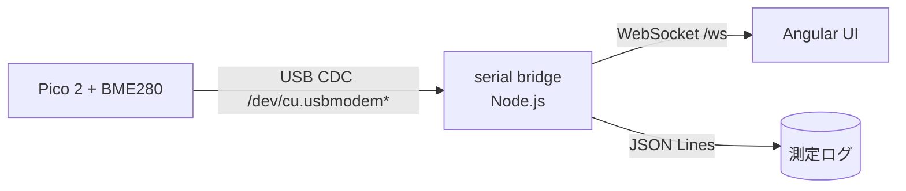

# pico2-bme280-monitor

Raspberry Pi Pico 2 (RP2350) + BME280 で温度・気圧・湿度を測定する C++ ファームウェアと、
PC 側の監視・配布用スクリプト。

実機で動作確認済みです。フラッシュ済みの Pico 2 を USB に接続するだけで、
2 秒間隔の測定値が USB シリアル（CDC）に流れ続けます。

```
=== BME280 C++ monitor (Pico 2 / RP2350) ===
I2C0 sda=GP4 scl=GP5 addr=0x76
I2C scan: 76
Calibration: T1=28651 T2=26756 T3=50
  P1=37438 P2=-10736 P3=3024 P4=10578 P5=-225 P6=-7 P7=9900 P8=-10230 P9=4285
  H1=75 H2=373 H3=0 H4=292 H5=50 H6=30
T=  23.77 C  P=  1002.95 hPa  RH= 49.83 %  |  dew= 12.68 C  AH=10.68 g/m3  (adc T=532928 P=276784 H=27471)
T=  23.77 C  P=  1002.94 hPa  RH= 50.99 %  |  dew= 13.03 C  AH=10.93 g/m3  (adc T=532927 P=276785 H=27673)
```

| 項目 | 値 |
|------|-----|
| 対象ボード | Raspberry Pi Pico 2 (RP2350) |
| センサー | BME280 (I2C, アドレス 0x76) |
| 言語 | C++17 (pico-sdk 2.1.1) |
| 算出値 | 温度 / 気圧 / 相対湿度 / 露点 / 絶対湿度 |
| ホストテスト | 55 assertions, 0 failures（ハードウェア不要） |

---

## 使い方

### 1. ツールチェーンの準備（初回のみ）

システム領域には何も書き込みません。既定では `~/toolchain/` 配下に揃えます。

```sh
scripts/setup-toolchain.sh            # 既存なら --dir で場所を変更可能
```

Arm GNU Toolchain 13.2.rel1、pico-sdk 2.1.1、picotool（libusb 付き）を取得・ビルドします。
`cmake` と `libusb` が必要です（macOS: `brew install cmake libusb`、Debian 系: `apt install cmake libusb-1.0-0-dev`）。

### 2. ビルド / テスト / 書き込み

```sh
scripts/build.sh      # firmware/build/bme280_monitor.uf2
scripts/test.sh       # ホスト単体テスト（Pico 不要）
scripts/flash.sh      # 接続済み Pico 2 へ書き込み + verify + reboot
scripts/monitor.py    # 測定値をコンソールへ
```

`flash.sh` は BOOTSEL モード・アプリモードのどちらでも動作します。アプリモードなら
動作中のファームウェアに BOOTSEL への再起動を要求し、応答しない場合は BOOTSEL
ボタンを押しながら差し直すよう案内します。

### 3. 測定値を見る

```sh
scripts/monitor.py                          # 人間向けテキスト
scripts/monitor.py --json --seconds 60      # 1 サンプル 1 行の JSON
```

JSON 出力は今後の UI やサービス連携がそのまま食える形にしてあります。

```json
{"port": "/dev/cu.usbmodem1101", "ts": 1793540966.76, "temperature_c": 23.26,
 "pressure_hpa": 1003.08, "humidity_rh": 50.35, "dew_point_c": 12.37,
 "absolute_humidity_gm3": 10.49, "adc_t": 531342, "adc_p": 276178, "adc_h": 27563}
```

---

## 配線

| BME280 | Pico 2 |
|--------|--------|
| VIN    | 3V3(OUT) |
| GND    | GND |
| SDA    | GP4 |
| SCL    | GP5 |

RP2350 の I2C0 パッドは RP2040 と機能が異なります（`hardware_regs/io_bank0.h` で確認）。
**GP4 = I2C0_SDA、GP5 = I2C0_SCL** です。元の MicroPython スクリプトは
`scl=Pin(4), sda=Pin(5)` という結線假设で、Pico 2 では `ValueError: bad SCL pin`
で弾かれていました。基板上の LED は GP25 です。

内部プルアップを有効化しているため、外部プルアップ抵抗がなくても動作します
（長い配線や 100 kHz 超では外部プルアップを推奨）。

---

## 診断機能

シリアルコンソールが無くても状態が分かるようになっています。

| LED (GP25) | 意味 |
|------------|------|
| 起動時に 3 回速点滅 | プログラムが実行中 |
| 低速 heartbeat | 0x76 に応答する BME280 が見つからない |
| サンプルごとに 1 回点滅 | 正常な測定値を取得 |

- **全 I2C 転送を 50 ms で制限**（`kBusTimeoutUs`）。pico-sdk の素のブロッキング呼び出しは
  バスが滞留すると無限に待つため、センサー未給電や配線ミスでプログラム全体が
  ハングします。
- **6 秒のウォッチドッグ**。何か詰まっても自動リセットで USB に再出現します。
  次回起動時に `NOTE: the previous run was reset by the watchdog` と表示されるため、
  障害が見えなくなるしません。

---

## リポジトリ構成

```
firmware/            pico-sdk C++ ファームウェア（本体）
  src/bme280_math.*    Bosch 参照実装準拠の補償計算 + 露点・絶対湿度
  src/bme280.*         I2C ドライバ（レジスタ定義、校正読み出し、測定シーケンス）
  src/i2c_scan.*       I2C バススキャン（テスト可能に切り出し）
  src/main.cpp         起動処理、診断出力、測定ループ
  test/                ホスト単体テスト + 模擬 BME280
scripts/             セットアップ / ビルド / テスト / 書き込み / 監視
legacy/              元の MicroPython スクリプト（参考保存、動作しません）
docs/                追加ドキュメント
  review-findings.md   元の Python 実装で確認した問題と証拠
  roadmap.md           測定条件の設定化・Angular UI・サービス化の実装方針
```

---

## これまでの経緯

### 1. 元の MicroPython 実装のレビュー（`legacy/`）

`bme280_calibrated.py` を、`machine` / `time` をスタブした実行ハーネスで実際に動かしながら
検証しました。**18 件の指摘**（CRITICAL 6 / HIGH 7 / MEDIUM 3 / LOW 2）のうち、主要なものは
「そもそも完走しない」「走っても値が物理的に意味をなさない」類のものでした。

| # | 深刻度 | 内容 |
|---|--------|------|
| 1 | CRITICAL | 補償係数 `dig_H5` を参照するが、校正読み出しで `dig_H4` までしか取得しておらず `AttributeError` で落ちる |
| 2 | CRITICAL | 気圧校正係数を **制御バンク 0xE8..0xF8** から読み出していた（正しくは 0x8E..0x9F）。読み出し先が間違っているため値は完全なゴミ |
| 3 | CRITICAL | 出力レジスタは **気圧が先**（0xF7=press, 0xFA=temp, 0xFD=hum）だが、温度を先に読んでおり T と P が入れ替わっている |
| 4 | CRITICAL | `hum_ctrl`（0xA2）に一度も書き込んでおらず、湿度のオーバーサンプリング設定が確定しない |
| 5 | CRITICAL | `t_fine` のスケールが約 680〜920 倍ずれている（Bosch 参照実装は 16 ビット固定小数、元コードは別スケールで混用） |
| 6 | CRITICAL | `float >> int` で `TypeError`。補償計算は整数演算前提なのに float をシフトしている |
| 7 | HIGH | `adc_P` を読み出しているが計算に使っていない |
| 8 | HIGH | 露点計算で `exp()` 用の定数に対して `pow(10, ·)` を使っている（対数の底が不一致） |

このレビューで、**Bosch 公式 `BME280_driver` の補償式が唯一の正しい基準**であることが
確定しました。温度補償が `t_fine` を設定し、気圧（64 ビット）と湿度がそれを使うため、
**必ず温度から先に補償する**必要があります。

### 2. 実機からのグラウンドトゥルース取得

C++ 実装の検証基準を作るため、MicroPython の raw REPL 経由で実モジュールから
実データを取得しました。

```
T1=28651 T2=26756 T3=50
P1..P9 = 37438,-10736,3024,10578,-225,-7,9900,-10230,4285
H1=75 H2=373 H3=0 H4=292 H5=50 H6=30
adc_T=529370 adc_P=275403 adc_H=27985
  -> 22.638 C, 1003.286 hPa, 52.744 %RH (t_fine=115882)
```

この値はそのままホストテストの検証式になっています（`firmware/test/` の模擬 BME280 は
この校正バンクを内蔵）。Bosch 公式ドライバ（`bme280.c`）の計算結果とも一致を確認しました。

### 3. C++ への書き換え

Python は使わず C++（pico-sdk）で実装し直し、以下の設計としました。

- **補償計算と I2C ドライバを分離**。補償計算は純粋な関数で、ハードウェアが無くてもテスト可能。
- **ホスト単体テスト**。pico-sdk のヘッダをスタブし、模擬 BME280 レジスタファイルに対して
  実ドライバコードをそのまま実行。55 assertions で、上記のバグクラスを全て回帰テスト化。
- **I2C 転送は全てタイムアウト付き**。
- **診断出力**（LED・ウォッチドッグ）。

### 4. ハードウェアがサイレントに死んだ事件と、その原因

書き込み済みのファームウェアがシリアル出力ゼロになり、やがて **USB バスから基板自体が
消える**という症状が発生しました。`picotool reboot`、1200 ボーによる BOOTSEL 要求、
pyusb からのリセット、いずれも無反応。物理的な差し直し以外に復旧手段が無い状態になりました。

原因は自分のコードに 2 つ重なっていました。

**(a) I2C スキャンが全アドレスを検出していた**

pico-sdk の `i2c_write_blocking(i2c, addr, nullptr, 0, false)` は、`len == 0` の場合
**書き込みループの本体が一度も実行されません**。つまり何も送信せずに成功（0）を返すため、
スキャンは 0x08〜0x77 の **112 アドレス全て**を「存在する」と判定していました。

**(b) その誤検出がバッファ溢れを起こしていた**

スキャン結果は 96 バイトの固定バッファに積み上げていました。

```cpp
n += std::snprintf(line + n, sizeof(line) - n, " %02X", addr);
```

`snprintf` は**切り詰め前の必要長**を返すため、`n` が 96 を超えた瞬間に
`sizeof(line) - n` が `size_t` でアンダーフローし、途方もない大きさのサイズ引数になります。
以降の `snprintf` はスタックを任意の距離だけ書き潰し、RP2350 がハードフォールト。
USB スタックもろとも死に、デバイスがバスから消えていました。

112 アドレス × 約 3 文字 = 約 345 文字を 96 バイトに詰め込もうとしたわけで、
**必ず起きる事故**でした。修正は「プローブを 1 バイト読み出しに変更」＋
「固定バッファへの積み上げをやめてプローブごとに `printf`」です。

この経験から得られた 2 つの教訓を `firmware/README.md` にも明記しています。

> - `i2c_write_blocking(i2c, addr, nullptr, 0, false)` は何も送信せず、全アドレスに成功を返す。
>   バススキャンには 1 バイト読み出しを使うこと（デバイスレジスタにも触れない）。
> - `n += snprintf(buf + n, sizeof(buf) - n, ...)` は危険。`snprintf` は切り詰め前の長さを返すため、
>   `n > sizeof(buf)` 以降のサイズ引数がラップアラウンドする。

### 5. 復旧と検証

ウォッチドッグ（6 秒）を導入したことで、以後は同じ症状が起きても自動で USB に
再出現するようになりました。基板の再出現を監視するスクリプトで差し直しを待ち、
BOOTSEL 検出 → `picotool load` → `verify` → `reboot` → シリアル capture を一本化した
`scripts/flash.sh` で復旧・検証を完了しています。

macOS ではマスストレージボリュームへの UF2 コピー（`cp`、`ls`、`diskutil unmount` すべて）が
ハングするため、**picotool を libusb 付きでビルドして USB から書き込む**方法を採用しています。
`setup-toolchain.sh` がこのビルドを含んでいます。

### 6. その他の修正

- **起動直後の出力が失われていた**：`PICO_STDIO_USB_CONNECT_WAIT_TIMEOUT_MS` の既定値が 0 で、
  ホストが CDC ポートをオープンする前の banner・スキャン結果・校正ダンプが破棄されていました。
  3 秒待機に変更。
- **効かないリンクオプション**：`-u_printf_float` は newlib-nano 向けの手法で、pico-sdk は
  独自の `pico_printf`（`_ftoa`/`_etoa` を内蔵、`%f` 対応済み）を使うため無関係でした。
  未定義シンボル `_printf_float` を残すだけだったので削除。現在 ELF の未定義シンボルはゼロ。

---

## 今後の展望

以下は意図的にまだ実装していません。設計方針をここに記録しておきます。

### A. 測定条件を任意の値に変更できるようにする

現状、サンプル間隔（2 秒）も出力桁数もオーバーサンプリングもソースに定数として
ハードコードされています。これを設定化します。

**設定項目（予定）**

| 項目 | 現状 | 予定 |
|------|------|------|
| サンプル間隔 | 2000 ms 固定 | 任意（ms） |
| 出力桁数（小数点制度） | `%7.2f` 等が固定 | 項目ごとに指定 |
| 平均回数（サンプリング数） | なし（1 回） | N 回平均、移動平均の窓長 |
| 温度/気圧/湿度のオーバーサンプリング | `OSR_X1` 固定 | `x1..x16` を個別指定 |
| IIR フィルタ | x16 固定 | `x2..x16` |
| センサーアドレス | 0x76 固定 | 0x76 / 0x77 |
| 測定モード | normal（連続） | normal / forced |

**実装方針**

1. **ファームウェア側**：設定を `struct Config` に集約し、シリアルで受け取る
   コマンドラインプロトコルを追加します。テキストのままでも良いので、
   `set interval=1000` / `set decimals=3` / `set osr.p=4` のような行を受け付け、
   `ok` / `error: ...` で応答する形を想定。
2. **平均と移動平均**：BME280 の ADC 値に対して適用します（補償計算後ではなく前に
   適用する方が、センサーのノイズ特性に合います）。
3. **PC 側**：`scripts/monitor.py` に `--interval` / `--decimals` / `--average` を追加し、
   ファームウェアへ `set` コマンドを送って同期します。
4. **永続化**：設定をフラッシュ上の 1 ページ（`pico_flash` または `pico_bootrom` の
   パーティション API）に保存し、再起動後も維持します。

注意点として、オーバーサンプリングを上げると 1 サンプルあたりの変換時間が伸びます
（BME280 のデータシート上の典型変換時間 × OSR）。サンプル間隔と整合させる検証が
必要です。

### B. 測定結果をリアルタイム表示する Angular UI

`ui/` に Angular アプリを置き、PC 側の小さなブリッジがシリアルを中継する構成を予定しています。



**設計方針**

- **ブリッジ**：`ui/server/` に Node.js（`serialport` + `ws`）。シリアル自動検出
  （`vid=0x2E8A pid=0x0009` で絞り込む）、再接続、JSON Lines でのローカル保存。
- **Angular 側**：
  - 現在値の大きな表示（温度 / 気圧 / 湿度 / 露点 / 絶対湿度）
  - 時系列チャート（`ngx-charts` または ECharts）。数分〜数日窓を切り替え
  - 測定条件パネル（A の `set` コマンドを UI から操作）
  - 接続状態・センサー状態（ファームウェアの診断出力をそのまま状態として表示）
- **データ形式**：`scripts/monitor.py --json` の出力をそのまま流用します。
  `ts` / `temperature_c` / `pressure_hpa` / `humidity_rh` / `dew_point_c` /
  `absolute_humidity_gm3` / `adc_*` が既に揃っています。
- **WebSocket**：単発の値だけでなく、`hello`（接続時の校正ダンプ）、`sample`、
  `status`（センサー消失・ウォッチドッグリセット）のイベント型を想定。

### C. インストールしてサービスとして起動すると、Pico を差すだけで測定できる環境

狙いは「ドライバー的な常駐サービスを入れておけば、以後はケーブルを挿すだけで
測定が始まり、UI ですぐ見える」状態です。

**方針**

1. **常駐サービス**：`scripts/` にデーモンを追加し、シリアルの**接続/切断を監視**して
   接続時に自動で読み取りを開始します。
   - Linux: `udev` ルール（`ATTRS{idVendor}=="2e8a", ATTRS{idProduct}=="0009"`）で
     `/dev/bme280` のような安定したシンボリックリンクを作り、`systemd` サービスで起動。
     プラグイン検知は `systemd.socket` の `BindPaths` または `pyudev` のイベントループ。
   - macOS: `launchd` の `KeepAlive` + シリアル検出ループ（`/dev/cu.usbmodem*` の出現監視）。
   - Windows: `New-EventLog`/WMI ではなく `serialport` のライブラリ側検出を予定。
2. **安定したデバイス名**：ベンダ/プロダクト ID で識別し、`/dev/bme280` などの固定名で
   開けるようにします（`/dev/cu.usbmodem1101` のような番号は再起動で変わります）。
3. **HTTP / WebSocket サーバー**：サービスがそのまま WebSocket を提供し、Angular UI を
   配信します（`http://localhost:PORT/`）。これで「挿す → ブラウザで見る」が成立します。
4. **履歴の保存**：JSON Lines（または SQLite）に追記し、UI 側の長期窓・CSV エクスポートに供します。
5. **インストール手順**：`scripts/install-service.sh`（Linux/macOS）と、サービス管理コマンド
   （`status` / `logs` / `uninstall`）を用意する想定です。

**未解決の論点**

- pico-sdk の CDC は USB シリアルを 1 本しか提供しないため、**設定コマンドと測定値が同じ
  チャネルを共有**します。テキストプロトコルで多重化するか、ベンダーインターフェースを
  別途使うかの選択が必要です。
- macOS では `launchd` からのシリアルアクセスに権限設定が必要になる可能性があります。
- ファームウェア側の設定永続化（A の 4）を先にやっておくと、サービスが無くても
  「挿すだけ」の挙動が素の基板で再現でき、テストしやすくなります。

---

## 開発

### ホストテスト（ハードウェア不要）

```sh
scripts/test.sh
```

補償計算は Bosch 参照実装と実測グラウンドトゥルースで固定し、ドライバのレジスタ操作は
模擬 BME280 に対して検証しています。カバーしている項目：

- 基準値との一致（22.638 °C / 1003.286 hPa / 52.744 %RH）
- クランプ動作、露点・絶対湿度・飽和水蒸気圧
- 校正バンクの解析（`0x88..0xA1` と `0xE1..0xE7`、H4/H5 のニブル結合）
- 読み出し順序（気圧が先）、ステータスポーリング
- `ctrl_hum` を `ctrl_meas` より先に書く順序
- チップ ID 不一致の拒否、NACK 処理、滞留バスでの即失敗
- スキャンの誤検出回帰テスト

### ファームウェアの詳細

[firmware/README.md](firmware/README.md)

---

## GitHub への公開

このリポジトリは非公開リポジトリとして配布することを想定しています。

```sh
scripts/login.sh          # GitHub 認証（ブラウザで認可するデバイスコード方式）
scripts/login.sh --token  # Personal Access Token を貼り付ける方式
scripts/publish.sh        # リポジトリ作成 + push
```

`publish.sh` は認証済みのアカウントに対して `pico2-bme280-monitor` という名前の
**非公開**リポジトリを作成し（既存なら再利用）、`origin` を設定して push します。
リポジトリ名や公開設定は環境変数で変えられます。

```sh
REPO_NAME=my-new-name VISIBILITY=public scripts/publish.sh
```

`gh` CLI が入っていない場合は `scripts/setup-toolchain.sh` が併せてインストールします。

---

## ライセンス

[MIT](LICENSE)
