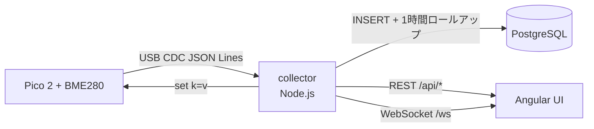

# pico2-bme280-monitor

Raspberry Pi Pico 2 (RP2350) + BME280 で温度・気圧・湿度を測定する C++ ファームウェア、
PostgreSQL への履歴保存、Angular のダッシュボード / 設定 UI、そして PC 側の
監視・配布用スクリプト。

実機で動作確認済みです。フラッシュ済みの Pico 2 を USB に接続するだけで、
2 秒間隔の測定値が USB シリアル（CDC）に流れ続けます。

```
=== BME280 C++ monitor (Pico 2 / RP2350) ===
I2C0 sda=GP4 scl=GP5 addr=0x76
I2C scan: 76
Calibration: T1=28651 T2=26756 T3=50
  P1=37438 P2=-10736 P3=3024 P4=10578 P5=-225 P6=-7 P7=9900 P8=-10230 P9=4285
  H1=75 H2=373 H3=0 H4=292 H5=50 H6=30
T=  23.77 C  P=  1002.95 hPa  RH= 49.83 %  |  dew= 12.68 C  AH=10.68 g/m3  (adc T=532928 P=276784 H=27471)
T=  23.77 C  P=  1002.94 hPa  RH= 50.99 %  |  dew= 13.03 C  AH=10.93 g/m3  (adc T=532927 P=276785 H=27673)
```

| 項目 | 値 |
|------|-----|
| 対象ボード | Raspberry Pi Pico 2 (RP2350) |
| センサー | BME280 (I2C, アドレス 0x76) |
| 言語 | C++17 (pico-sdk 2.1.1) |
| 算出値 | 温度 / 気圧 / 相対湿度 / 露点 / 絶対湿度 |
| 測定条件 | 実行中にシリアルで変更可能（間隔・桁数・平均・OSR・フィルタ・モード） |
| 最速測定間隔 | 5 ms（実測 約 173 サンプル/秒。BME280 の物理上限 約 190 Hz が頭打ち） |
| ホストテスト | 124 assertions, 0 failures（ハードウェア不要） |
| UI | Angular 22（ダッシュボード / 測定設定の 2 画面、参数別の個別グラフ） |
| 履歴 | PostgreSQL（時系列 + 1 時間ロールアップ） |

---

## 使い方

### 1. ツールチェーンの準備（初回のみ）

システム領域には何も書き込みません。既定では `~/toolchain/` 配下に揃えます。

```sh
scripts/setup-toolchain.sh            # 既存なら --dir で場所を変更可能
```

Arm GNU Toolchain 13.2.rel1、pico-sdk 2.1.1、picotool（libusb 付き）を取得・ビルドします。
`cmake` と `libusb` が必要です（macOS: `brew install cmake libusb`、Debian 系: `apt install cmake libusb-1.0-0-dev`）。

### 2. ビルド / テスト / 書き込み

```sh
scripts/build.sh      # firmware/build/bme280_monitor.uf2
scripts/test.sh       # ホスト単体テスト（Pico 不要）
scripts/flash.sh      # 接続済み Pico 2 へ書き込み + verify + reboot
scripts/monitor.py    # 測定値をコンソールへ
```

`flash.sh` は BOOTSEL モード・アプリモードのどちらでも動作します。アプリモードなら
動作中のファームウェアに BOOTSEL への再起動を要求し、応答しない場合は BOOTSEL
ボタンを押しながら差し直すよう案内します。

#### ツールチェーンを使いたくない場合（プリビルド UF2）

`v*` タグを push すると GitHub Actions がファームウェアをビルドし、
`bme280_monitor.uf2` と `SHA256SUMS` を **Release に添付**します
（[Releases](https://github.com/taakad/pico2-bme280-monitor/releases)）。

書き込みはどちらでもできます。

```sh
# A. このリポジトリのスクリプトを使う（ファームウェアのビルドは不要、picotool が必要）
scripts/flash.sh ~/Downloads/bme280_monitor.uf2

# B. ボタン操作だけ
#    1. BOOTSEL ボタンを押しながら USB 接続（または BOOTSEL 押下中に reset）
#    2. RPI-RP2 に bme280_monitor.uf2 をドラッグ&ドロップ
```

### 3. 測定値を見る

```sh
scripts/monitor.py                          # 人間向けテキスト
scripts/monitor.py --json --seconds 60      # 1 サンプル 1 行の JSON
```

JSON 出力は今後の UI やサービス連携がそのまま食える形にしてあります。

```json
{"port": "/dev/cu.usbmodem1101", "ts": 1793540966.76, "temperature_c": 23.26,
 "pressure_hpa": 1003.08, "humidity_rh": 50.35, "dew_point_c": 12.37,
 "absolute_humidity_gm3": 10.49, "adc_t": 531342, "adc_p": 276178, "adc_h": 27563}
```

### 4. 測定条件を途中で変える（リフラッシュ不要）

ファームウェアは起動後もシリアルコンソールで設定を受け付けます。
`scripts/config.py` がそのプロトコルの CLI です。

```sh
scripts/config.py --get                       # 現在の設定を表示
scripts/config.py --set interval=1000         # 測定間隔を 1 秒に
scripts/config.py --set interval=5            # 最速（BME280 の物理上限 約 190 Hz）
scripts/config.py --set decimals=3            # 小数 3 桁で出力
scripts/config.py --set average=8             # 生の ADC 値を 8 件移動平均
scripts/config.py --set osr.t=4 --set filter=2 # オーバーサンプリング / IIR フィルタ
scripts/config.py --set mode=forced           # 連続 / 単発
scripts/config.py --set json=true             # 1 サンプル 1 行の JSON 出力
```

デバイス側が値を検証し、`ok <key>=<value>` か `error: <理由>` で応答します。
不正な値は現在の設定を一切変更しません。設定項目と有効範囲は
`docs/roadmap.md` の A 節に表にしてあります。

**測定間隔の下限は 5 ms** です。BME280 のデータシート上の最大出力データレートは
約 190 Hz（OSR x1/x1/x1・standby 0.5 ms）なので、20 kHz のようなレートはこの
センサーでは物理的に達成できません。実測では `set interval=5` で
**約 173 サンプル/秒**（collector 経由で DB 保存しても約 160/秒）に達し、
センサー限界にほぼ張り付きます。それより短い間隔を指定しても、ループは
センサーのペースに自然に收敛します（エラーにはなりません）。

### 5. ダッシュボードと設定 UI（collector サービス）

Pico を挿したまま collector を起動すると、測定値が PostgreSQL に蓄積され、
Angular の 2 画面（ダッシュボード / 測定設定）で確認できます。
ダッシュボードは 5 参数のゲージに加え、**参数ごとに個別の推移グラフ**を表示します
（°C / hPa / %RH を同一軸に重ねると縦軸が読めないため、グラフごとに目盛りを持ちます）。

前提: Node.js 20+ と PostgreSQL。PostgreSQL は管理者権限なしで
`~/toolchain/pgsql` に Postgres.app から展開して 5433 で起動しています。

```sh
# 一键: DB 起動（無ければ initdb）→ スキーマ適用 → UI ビルド → collector 起動
scripts/collector.sh
# → http://127.0.0.1:8787  （ビルド済み ui/dist を同じプロセスが配信）
```

手動で組む場合:

```sh
# 1. データベース作成（初回のみ）
createdb -h /tmp -p 5433 -U pico pico_monitor

# 2. collector 起動（シリアル自動検出・再接続、REST + WebSocket + UI 配信）
cd server && npm install
PGHOST=/tmp PGPORT=5433 PGDATABASE=pico_monitor PGUSER=pico npm start
# → http://127.0.0.1:8787  （ビルド済み ui/dist を同じプロセスが配信）

# 開発時は Angular デバウザー（proxy.conf.json で 8787 へ中継）
cd ui && npm install && npm start     # http://localhost:4200
```

- **ダッシュボード** `/dashboard`：5 パラメータ（温度・気圧・相対湿度・露点・絶対湿度）を
  SVG のアークゲージで現在値表示し、WebSocket でリアルタイム更新。期間切り替え
  （1 時間 / 24 時間 / 7 日 / 30 日）で PostgreSQL の履歴を折れ線グラフ表示。
- **測定設定** `/settings`：A の設定項目をフォームで編集し、`PUT /api/settings`
  経由でファームウェアへ反映。値はサーバー側とデバイス側の両方で検証されます。

REST API（collector が提供）:

| メソッド | パス | 内容 |
|----------|------|------|
| GET | `/api/health` | collector とシリアルの状態 |
| GET | `/api/latest` | 最新サンプル |
| GET | `/api/measurements?from&to&bucket` | 履歴（bucket: raw/1m/5m/…/1d） |
| GET | `/api/settings` | 現在の設定（デバイス優先、無ければ DB） |
| PUT | `/api/settings` | 設定をデバイスへ適用 |
| WS  | `/ws` | `hello` / `sample` / `config` / `status` / `batch` |

---

## 配線

| BME280 | Pico 2 |
|--------|--------|
| VIN    | 3V3(OUT) |
| GND    | GND |
| SDA    | GP4 |
| SCL    | GP5 |

RP2350 の I2C0 パッドは RP2040 と機能が異なります（`hardware_regs/io_bank0.h` で確認）。
**GP4 = I2C0_SDA、GP5 = I2C0_SCL** です。元の MicroPython スクリプトは
`scl=Pin(4), sda=Pin(5)` という結線假设で、Pico 2 では `ValueError: bad SCL pin`
で弾かれていました。基板上の LED は GP25 です。

内部プルアップを有効化しているため、外部プルアップ抵抗がなくても動作します
（長い配線や 100 kHz 超では外部プルアップを推奨）。

---

## 診断機能

シリアルコンソールが無くても状態が分かるようになっています。

| LED (GP25) | 意味 |
|------------|------|
| 起動時に 3 回速点滅 | プログラムが実行中 |
| 低速 heartbeat | 0x76 に応答する BME280 が見つからない |
| サンプルごとに 1 回点滅 | 正常な測定値を取得 |

- **全 I2C 転送を 50 ms で制限**（`kBusTimeoutUs`）。pico-sdk の素のブロッキング呼び出しは
  バスが滞留すると無限に待つため、センサー未給電や配線ミスでプログラム全体が
  ハングします。
- **6 秒のウォッチドッグ**。何か詰まっても自動リセットで USB に再出現します。
  次回起動時に `NOTE: the previous run was reset by the watchdog` と表示されるため、
  障害が見えなくなるしません。

---

## リポジトリ構成

```
firmware/            pico-sdk C++ ファームウェア（本体）
  src/bme280_math.*    Bosch 参照実装準拠の補償計算 + 露点・絶対湿度
  src/bme280.*         I2C ドライバ（レジスタ定義、校正読み出し、測定シーケンス）
  src/config.*         実行中に変更できる測定設定（検証付き）
  src/command.*        シリアル設定プロトコル（set/get/help/ping）
  src/sampler.*        生の ADC 値への移動平均
  src/i2c_scan.*       I2C バススキャン（テスト可能に切り出し）
  src/main.cpp         起動処理、診断出力、測定ループ、コマンドループ
  test/                ホスト単体テスト + 模擬 BME280
server/              collector サービス（Node.js）
  src/serial.js        シリアル自動検出・再接続・JSON 解析・設定送信
  src/db.js            PostgreSQL スキーマ適用 / INSERT / 系列クエリ
  src/api.js           REST + WebSocket + 設定検証 + UI 配信
  src/index.js         起動・バッチ保存・イベント配線
  test/                プロトコル解析と DB round trip のテスト
db/schema.sql        PostgreSQL スキーマ（device / measurement / 設定 / 1 時間集計）
ui/                  Angular 22 アプリ
  src/app/dashboard/   SVG ゲージ + 履歴グラフ（ダッシュボード画面）
  src/app/settings/    測定設定フォーム（設定画面）
  src/app/gauge/       アークゲージ（依存なしの手描き SVG）
  src/app/history/     折れ線 + min/max 帯の手描き SVG チャート
scripts/             セットアップ / ビルド / テスト / 書き込み / 監視 / 設定
legacy/              元の MicroPython スクリプト（参考保存、動作しません）
docs/                追加ドキュメント
  review-findings.md   元の Python 実装で確認した問題と証拠
  roadmap.md           測定条件の設定化・Angular UI・サービス化の実装方針
```

---

## これまでの経緯

### 1. 元の MicroPython 実装のレビュー（`legacy/`）

`bme280_calibrated.py` を、`machine` / `time` をスタブした実行ハーネスで実際に動かしながら
検証しました。**18 件の指摘**（CRITICAL 6 / HIGH 7 / MEDIUM 3 / LOW 2）のうち、主要なものは
「そもそも完走しない」「走っても値が物理的に意味をなさない」類のものでした。

| # | 深刻度 | 内容 |
|---|--------|------|
| 1 | CRITICAL | 補償係数 `dig_H5` を参照するが、校正読み出しで `dig_H4` までしか取得しておらず `AttributeError` で落ちる |
| 2 | CRITICAL | 気圧校正係数を **制御バンク 0xE8..0xF8** から読み出していた（正しくは 0x8E..0x9F）。読み出し先が間違っているため値は完全なゴミ |
| 3 | CRITICAL | 出力レジスタは **気圧が先**（0xF7=press, 0xFA=temp, 0xFD=hum）だが、温度を先に読んでおり T と P が入れ替わっている |
| 4 | CRITICAL | `hum_ctrl`（0xA2）に一度も書き込んでおらず、湿度のオーバーサンプリング設定が確定しない |
| 5 | CRITICAL | `t_fine` のスケールが約 680〜920 倍ずれている（Bosch 参照実装は 16 ビット固定小数、元コードは別スケールで混用） |
| 6 | CRITICAL | `float >> int` で `TypeError`。補償計算は整数演算前提なのに float をシフトしている |
| 7 | HIGH | `adc_P` を読み出しているが計算に使っていない |
| 8 | HIGH | 露点計算で `exp()` 用の定数に対して `pow(10, ·)` を使っている（対数の底が不一致） |

このレビューで、**Bosch 公式 `BME280_driver` の補償式が唯一の正しい基準**であることが
確定しました。温度補償が `t_fine` を設定し、気圧（64 ビット）と湿度がそれを使うため、
**必ず温度から先に補償する**必要があります。

### 2. 実機からのグラウンドトゥルース取得

C++ 実装の検証基準を作るため、MicroPython の raw REPL 経由で実モジュールから
実データを取得しました。

```
T1=28651 T2=26756 T3=50
P1..P9 = 37438,-10736,3024,10578,-225,-7,9900,-10230,4285
H1=75 H2=373 H3=0 H4=292 H5=50 H6=30
adc_T=529370 adc_P=275403 adc_H=27985
  -> 22.638 C, 1003.286 hPa, 52.744 %RH (t_fine=115882)
```

この値はそのままホストテストの検証式になっています（`firmware/test/` の模擬 BME280 は
この校正バンクを内蔵）。Bosch 公式ドライバ（`bme280.c`）の計算結果とも一致を確認しました。

### 3. C++ への書き換え

Python は使わず C++（pico-sdk）で実装し直し、以下の設計としました。

- **補償計算と I2C ドライバを分離**。補償計算は純粋な関数で、ハードウェアが無くてもテスト可能。
- **ホスト単体テスト**。pico-sdk のヘッダをスタブし、模擬 BME280 レジスタファイルに対して
  実ドライバコードをそのまま実行。55 assertions で、上記のバグクラスを全て回帰テスト化。
- **I2C 転送は全てタイムアウト付き**。
- **診断出力**（LED・ウォッチドッグ）。

### 4. ハードウェアがサイレントに死んだ事件と、その原因

書き込み済みのファームウェアがシリアル出力ゼロになり、やがて **USB バスから基板自体が
消える**という症状が発生しました。`picotool reboot`、1200 ボーによる BOOTSEL 要求、
pyusb からのリセット、いずれも無反応。物理的な差し直し以外に復旧手段が無い状態になりました。

原因は自分のコードに 2 つ重なっていました。

**(a) I2C スキャンが全アドレスを検出していた**

pico-sdk の `i2c_write_blocking(i2c, addr, nullptr, 0, false)` は、`len == 0` の場合
**書き込みループの本体が一度も実行されません**。つまり何も送信せずに成功（0）を返すため、
スキャンは 0x08〜0x77 の **112 アドレス全て**を「存在する」と判定していました。

**(b) その誤検出がバッファ溢れを起こしていた**

スキャン結果は 96 バイトの固定バッファに積み上げていました。

```cpp
n += std::snprintf(line + n, sizeof(line) - n, " %02X", addr);
```

`snprintf` は**切り詰め前の必要長**を返すため、`n` が 96 を超えた瞬間に
`sizeof(line) - n` が `size_t` でアンダーフローし、途方もない大きさのサイズ引数になります。
以降の `snprintf` はスタックを任意の距離だけ書き潰し、RP2350 がハードフォールト。
USB スタックもろとも死に、デバイスがバスから消えていました。

112 アドレス × 約 3 文字 = 約 345 文字を 96 バイトに詰め込もうとしたわけで、
**必ず起きる事故**でした。修正は「プローブを 1 バイト読み出しに変更」＋
「固定バッファへの積み上げをやめてプローブごとに `printf`」です。

この経験から得られた 2 つの教訓を `firmware/README.md` にも明記しています。

> - `i2c_write_blocking(i2c, addr, nullptr, 0, false)` は何も送信せず、全アドレスに成功を返す。
>   バススキャンには 1 バイト読み出しを使うこと（デバイスレジスタにも触れない）。
> - `n += snprintf(buf + n, sizeof(buf) - n, ...)` は危険。`snprintf` は切り詰め前の長さを返すため、
>   `n > sizeof(buf)` 以降のサイズ引数がラップアラウンドする。

### 5. 復旧と検証

ウォッチドッグ（6 秒）を導入したことで、以後は同じ症状が起きても自動で USB に
再出現するようになりました。基板の再出現を監視するスクリプトで差し直しを待ち、
BOOTSEL 検出 → `picotool load` → `verify` → `reboot` → シリアル capture を一本化した
`scripts/flash.sh` で復旧・検証を完了しています。

macOS ではマスストレージボリュームへの UF2 コピー（`cp`、`ls`、`diskutil unmount` すべて）が
ハングするため、**picotool を libusb 付きでビルドして USB から書き込む**方法を採用しています。
`setup-toolchain.sh` がこのビルドを含んでいます。

### 6. その他の修正

- **起動直後の出力が失われていた**：`PICO_STDIO_USB_CONNECT_WAIT_TIMEOUT_MS` の既定値が 0 で、
  ホストが CDC ポートをオープンする前の banner・スキャン結果・校正ダンプが破棄されていました。
  3 秒待機に変更。
- **効かないリンクオプション**：`-u_printf_float` は newlib-nano 向けの手法で、pico-sdk は
  独自の `pico_printf`（`_ftoa`/`_etoa` を内蔵、`%f` 対応済み）を使うため無関係でした。
  未定義シンボル `_printf_float` を残すだけだったので削除。現在 ELF の未定義シンボルはゼロ。

### 7. 測定条件の設定化と UI（A・B の実装）

- **設定プロトコル**：`set/get/help/ping` の行単位テキストプロトコル。設定は
  `struct Config` に集約し、`applySetting()` はコピーに対して検証してから適用するため、
  不正な値は既存設定を一切変更しません。`get` は現在の設定を 1 行で返します。
- **平均は補償計算の前**：ADC 値への移動平均（窓長 ≤ 64、64bit 累算）を新設。
  補償計算後に平均するよりセンサーのノイズ特性に合います。
- **BME280 のレジスタ順序**：`ctrl_hum`(0xF2) を `ctrl_meas`(0xF4) より先に書かないと
  湿度 OSR が無視される、というデータシートの制約をテストで固定しました。
  standby は 500 ms（x16/x16/x16 の変換時間をカバー）。
- **詰まらないメインループ**：`getchar_timeout_us(0)` で非ブロッキングにコマンドを拾い、
  睡眠は 50 ms スライス（各スライスでウォッチドッグ更新＋コマンド処理）。
  `set interval=` は 50 ms 以内に反映されます。ウォッチドッグは 6 s 固定のまま
  （スライスが叩くので長い間隔でも誤発火せず、詰まりは 6 s で復旧）。
- **桁数**：`pico_printf` が `%*.*f` の `*` 精度指定に対応しているため、
  `decimals` はフォーマット文字列だけで反映されます。
- **JSON 出力モード**（`set json=true`）：collector が壊れにくい形でサンプルを
  受け取れます。`monitor.py` はこの JSON をそのまま透過します。
- **collector / UI**：Node.js の collector がシリアル自動検出・再接続し、
  PostgreSQL に保存（1 時間ロールアップ付き）、REST + WebSocket + 静的 UI を 1 プロセスで
  提供。Angular はゲージもグラフも依存ゼロの手描き SVG です。
- **検証**：実機で設定プロトコル 47 チェック、ヘッドレス Chrome で UI 20 チェック、
  いずれも全通過。UI から `decimals=4` を適用 → ゲージ表示が 4 桁になるまでを
  実機経由で確認しました。

### 高速化と参数別グラフ（改善ラウンド）

- **サンプリング速度**：間隔の下限を 100 ms → **5 ms** に引き下げました。ただし
  ボトルネックはループではなくセンサー自体にあります（BME280 の最大出力データレートは
  データシート上 約 190 Hz）。20 kHz はこのセンサーでは物理的に不可能なため、
  「センサーが許す最速」を正直なゴールにしました。達成のための変更：
  - I2C を 100 kHz → **400 kHz**（BME280 は Fast mode 対応。8 バイト読み出しが短くなる）
  - standby 時間を間隔から選択（< 1 s なら 0.5 ms、それ以上は 500 ms）
  - 変換待ちポーリングを `sleep_ms(1)` → `sleep_us(500)`（ミリ秒単位の遅延を排除）
  - LED ブリンクを間隔 ≥ 200 ms のときだけ 60 ms 睡眠（固定ブリンクが約 16 Hz の
    ループ上限になっていた）
  - 実測：`interval=5` で **173 samples/s**、`interval=10` で 92/s、`interval=50` で 20/s。
    collector + PostgreSQL 経由でも 160 samples/s をロストなく保存（バッチ INSERT と
    1 時間ロールアップはそのまま追従）
- **ダッシュボードのグラフ**：1 枚に 3 系列を重ねていた構成をやめ、
  **温度 / 気圧 / 相対湿度 / 露点 / 絶対湿度の 5 枚の個別グラフ**に分割。
  各グラフは独自の手目盛り（丸めた刻み値のラベル付き）を持ち、露点と絶対湿度も
  1 時間ロールアップに列を追加して長期窓対応。
- **検証**：ホスト 124 assertions、collector 6 tests、実機プロトコル 47 チェック
  （`interval=5` 受理 + 100 samples/s 以上のスループット確認を含む）、
  ヘッドレス Chrome 20 チェック（5 枚のグラフ・異なる 5 種の縦軸・設定画面の
  最短 5 ms / 190 Hz ヒントを確認）。すべて全通過。

---

## 今後の展望

### A. 測定条件を任意の値に変更できるようにする — 実装済み

シリアル設定プロトコル（`set/get/help/ping`）として実装しました。
設定項目・有効範囲・検証の挙動は [docs/roadmap.md](docs/roadmap.md) の A 節にあります。
使い方と実機検証結果は上の「4. 測定条件を途中で変える」にまとめてあります。

- 平均は補償計算 **前** の生の ADC 値に対して適用（設計方針どおり）
- 不正な値は `error` を返し、既存設定は変更されない
- 設定永続化（フラッシュ保存）は未実装。現状は再接続時に collector が
  前回設定を再送して再現する

### B. 測定結果をリアルタイム表示する Angular UI — 実装済み

`ui/`（Angular 22）と `server/`（collector）として実装しました。
設定画面と監視画面は別ルート（`/settings` と `/dashboard`）に分けてあります。



- **ダッシュボード**：5 参数の SVG アークゲージ（チャートライブラリなしの手描き SVG）、
  WebSocket によるリアルタイム更新、1 時間〜30 日の履歴グラフ（min/max 帯付き）。
  グラフは参数ごとに 1 枚ずつで、縦軸は各参数の目盛り（丸めた刻み値のラベル付き）
- **設定**：フォーム → `PUT /api/settings` → シリアル `set` → デバイス検証 →
  WebSocket `config` で全クライアントへ反映
- **DB スキーマ**：`db/schema.sql`（device / measurement / device_setting /
  measurement_hourly）。measurement は `(device_id, ts DESC)` にインデックス、
  長期窓は 1 時間ロールアップでスキャン量を抑制

### C. インストールしてサービスとして起動すると、Pico を差すだけで測定できる環境 — 未実装

collector はすでに「起動中に挿すと自動検出・自動開始・自動再接続」までできています
（`server/src/serial.js` の検出ループ）。残りは OS への常駐登録です。

**方針**

1. **常駐サービス**
   - Linux: `udev` ルール（`ATTRS{idVendor}=="2e8a"`）で `/dev/bme280` のような
     安定シンボリックリンクを作り、`systemd` サービスで collector を起動
   - macOS: `launchd` の `KeepAlive` + `launchctl bootstrap`（`scripts/install-service.sh` 想定）
   - Windows: `serialport` のライブラリ側検出を予定
2. **安定したデバイス名**：`/dev/cu.usbmodem1101` のような番号は再起動で変わるため、
   ベンダ ID で識別したポートを collector 側で追跡する（現状は接続のたびに再検出）
3. **HTTP サーバー**：collector が UI を同梱配信する形は実装済み
   （`http://localhost:8787/`）。「挿す → ブラウザで見る」はサービス登録だけで成立する
4. **履歴の保存**：PostgreSQL 保存は実装済み。CSV エクスポートは未実装
5. **設定の永続化**：ファームウェアのフラッシュ保存（A の残課題）をやると、
   サービス無しでも「挿すだけ」の挙動が素の基板で再現できる

**既知の論点**

- pico-sdk の CDC は USB シリアルを 1 本しか提供しないため、設定コマンドと
  測定値が同じチャネルを共有する。テキストプロトコルの行単位多重化で解決済み
- macOS の `launchd` からのシリアルアクセスの権限設定は未検証
- PostgreSQL を常駐させる場合の起動順序（DB → collector）の管理

---

## 開発

### ホストテスト（ハードウェア不要）

```sh
scripts/test.sh
```

補償計算は Bosch 参照実装と実測グラウンドトゥルースで固定し、ドライバのレジスタ操作は
模擬 BME280 に対して検証しています。カバーしている項目：

- 基準値との一致（22.638 °C / 1003.286 hPa / 52.744 %RH）
- クランプ動作、露点・絶対湿度・飽和水蒸気圧
- 校正バンクの解析（`0x88..0xA1` と `0xE1..0xE7`、H4/H5 のニブル結合）
- 読み出し順序（気圧が先）、ステータスポーリング
- `ctrl_hum` を `ctrl_meas` より先に書く順序
- チップ ID 不一致の拒否、NACK 処理、滞留バスでの即失敗
- スキャンの誤検出回帰テスト
- 設定の検証（範囲外・非数値・不正な OSR を拒否し、既存設定を変えない）
- シリアル行プロトコルの解析と過長行の破棄
- 生の ADC 値への移動平均（窓充填、ゼロサンプルスキップ、窓長クランプ）

### collector のテスト（ハードウェア不要）

```sh
cd server && npm test
```

シリアル設定プロトコルの解析、設定検証、PostgreSQL の INSERT / 系列クエリ /
1 時間ロールアップをカバーします（DB が無い環境では DB テストは自動スキップ）。

### ファームウェアの詳細

[firmware/README.md](firmware/README.md)

---

## GitHub への公開

このリポジトリは非公開リポジトリとして配布することを想定しています。

```sh
scripts/login.sh          # GitHub 認証（ブラウザで認可するデバイスコード方式）
scripts/login.sh --token  # Personal Access Token を貼り付ける方式
scripts/publish.sh        # リポジトリ作成 + push
```

`publish.sh` は認証済みのアカウントに対して `pico2-bme280-monitor` という名前の
**非公開**リポジトリを作成し（既存なら再利用）、`origin` を設定して push します。
リポジトリ名や公開設定は環境変数で変えられます。

```sh
REPO_NAME=my-new-name VISIBILITY=public scripts/publish.sh
```

`gh` CLI が入っていない場合は `scripts/setup-toolchain.sh` が併せてインストールします。

---

## ライセンス

[MIT](LICENSE)
