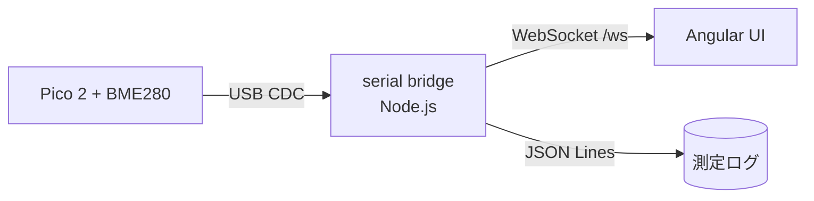

# ロードマップ

実装済みの範囲と、これからやることを技術的な方針まで書き残したものです。
概要は [../README.md](../README.md) の「今後の展望」にまとめてあります。

## 実装済み

- [x] pico-sdk C++ ファームウェア（補償計算 / I2C ドライバ / 診断）
- [x] ホスト単体テスト 124 assertions（模擬 BME280、ハードウェア不要）
- [x] 実行中の測定設定（シリアル `set/get`、検証付き、JSON 出力モード）
- [x] collector サービス（シリアル→PostgreSQL、REST + WebSocket、UI 配信）
- [x] 履歴の TimescaleDB 化（`measurement` を 1 日チャンクのハイパーテーブルに。
      `db/schema.sql` が冪等に変換、`scripts/db.sh` が preload 設定と再起動を自動化、
      CI は `timescale/timescaledb:latest-pg17` コンテナで DB テストを実行）
- [x] Angular ダッシュボード（SVG ゲージ + 履歴グラフ）と測定設定画面
- [x] セットアップ・ビルド・テスト・書き込み・監視スクリプト
- [x] JSON 出力（`scripts/monitor.py --json`）
- [x] 実機での測定確認（23.7 °C / 1003 hPa / 50 %RH を 2 秒間隔で安定取得）
- [x] GitHub Actions（push / PR でホストテスト + ファームウェアビルド）
- [x] `v*` タグで Release に UF2 と SHA256SUMS を添付
      → ツールチェーンなしでも `scripts/flash.sh <uf2>` かドラッグ&ドロップで書き込み可能
- [x] 非公開リポジトリへの配布（`scripts/login.sh` + `scripts/publish.sh`）

## A. 測定条件の設定化 — ✅ 実装済み

> 実装: `firmware/src/{config,command,sampler}.*` と
> `scripts/config.py`。実機で 47 チェック通過（間隔・桁数・平均窓・OSR/フィルタ・
> 10 種の不正値拒否・最速間隔のスループット・正常な測定値）。設定のフラッシュ永続化のみ未実装。
>
> **改善ラウンド**: 間隔の下限を 100 ms → 5 ms に。BME280 のデータシート上の最大
> 出力データレートは約 190 Hz（OSR x1/x1/x1・standby 0.5 ms）なので、これがセンサー側
> の物理上限。実測で `interval=5` 時に 173 samples/s（I2C 400 kHz、standby 間隔連動、
> µs 単位ポーリング、間隔連動 LED ブリンクで達成）。

**当時**：サンプル間隔・出力桁数・オーバーサンプリングはすべてソースの定数。

```cpp
constexpr uint32_t kSampleIntervalMs = 2000;   // main.cpp
constexpr uint8_t  OSR_X1 = 0b001;             // bme280.hpp
// 出力は printf の %7.2f 等に固定
```

**設定したい項目**

| 項目 | 現状 | 目標 |
|------|------|------|
| サンプル間隔 | 2000 ms | 5 ms..3600000 ms（センサー上限 約 190 Hz） |
| 出力桁数 | `%7.2f` 固定 | 項目ごとに指定 |
| 平均回数 | 1 回 | N 回平均 / 移動平均の窓長 |
| OSR（T/P/H） | `x1` 固定 | `x1..x16` を個別指定 |
| IIR フィルタ | x16 固定 | `x2..x16` |
| センサーアドレス | 0x76 | 0x76 / 0x77 |
| 測定モード | normal（連続） | normal / forced |

**実装順（依存関係）**

1. **`struct Config` に集約**（ファームウェア）。定数をグローバルな設定構造体に置き換え、
   `begin()` が設定を反映する形にする。この時点でテストは設定既定値で通るはず。
2. **シリアルコマンドプロトコル**。1 行 1 コマンドのテキスト：
   ```
   set interval=1000
   set decimals.temp=3
   set osr.p=4
   get interval
   ```
   応答は `ok` または `error: <理由>`。不正値は却下して現在値を維持する。
3. **フラッシュへの永続化**。`pico_bootrom` のパーティション API または
   `pico_flash` で 1 ページを予約し、CRC 付きで保存。破損時は既定値にフォールバック。
4. **平均 / 移動平均**。**ADC 値に対して**適用する（補償計算の前）。
   BME280 のノイズは ADC 段で平均した方が補償計算の非線形性を壊しません。
5. **PC 側**：`scripts/monitor.py --interval/--decimals/--average` が `set` を送って同期。

**既知の注意点**

- OSR を上げると 1 サンプルの変換時間が伸びる（データシート上の典型変換時間 × OSR）。
  サンプル間隔より変換時間が長い場合は、間隔に clamp するか forced モードで明示的に
  トリガする方が安全。→ 実装では変換完了待ちが自然にスロットル役を果たす
  （間隔 5 ms を指定しても約 173 Hz で收敛。エラーにはならない）。
- **20 kHz は不可能**：BME280 の最大出力データレートは約 190 Hz。I2C の転送時間より
  センサーの変換時間が支配的。それ以上のレートが必要なら別のセンサー（例: SHT シリーズ
  でも同じく ~Hz 級。kHz 級はセンサーではなく ADC 系の話）が必要。
- **設定と測定値が同じ CDC チャネルを共有する**。pico-sdk の CDC は 1 本。
  テキストプロトコルで多重化するか、ベンダーインターフェースを別途使うかの選択が必要。
  前者が単純で、`T=` で始まる行は測定値、`set `/`get ` はコマンドと判別できる。

## B. Angular リアルタイム UI — ✅ 実装済み

> 実装: `ui/`（Angular 22、`/dashboard` と `/settings` の 2 画面）と
> `server/`（collector: serialport + pg + express + ws）。`db/schema.sql` に
> device / measurement / device_setting / measurement_hourly。ヘッドレス Chrome で
> 20 チェック通過（5 ゲージ描画・参数別 5 グラフと個別縦軸・リアルタイム更新・
> 期間切替・設定適用の反映・最短 5 ms / 190 Hz ヒント）。
>
> **改善ラウンド**: 履歴グラフを 1 枚 3 系列の重ね描きから**参数別 5 枚**に分割。
> 各グラフは独自の手目盛り（丸めた刻み値のラベル）を持つ。露点・絶対湿度も
> `measurement_hourly` に avg/min/max 列を追加して長期窓に対応（マイグレーションは
> `ALTER TABLE ... ADD COLUMN IF NOT EXISTS` + 既存ロールアップの backfill で冪等）。

**構成（設計時）**



**ブリッジ（`ui/server/`）**

- Node.js + `serialport` + `ws`
- シリアル自動検出：`vid=0x2E8A, pid=0x0009`（RP2350 の CDC）で絞り込む
- 切断時の再接続、再接続時に `hello` イベントで校正情報を再送
- JSON Lines でローカル保存（長期窓と CSV エクスポートの元）

**Angular 側**

- 現在値の大きな表示：温度 / 気圧 / 相対湿度 / 露点 / 絶対湿度
- 時系列チャート（`ngx-charts` か ECharts）。数分〜数日の窓を切り替え
- 測定条件パネル → A の `set` コマンドを UI から送る
- 接続状態とセンサー状態。ファームウェアの診断出力（`I2C scan: (none)`、
  `BME280 not ready`、`NOTE: the previous run was reset by the watchdog`）を
  そのまま状態イベントとして UI に出す

**WebSocket イベント型（予定）**

| type | 内容 |
|------|------|
| `hello` | 接続直後。校正バンク、検出したアドレス、ウォッチドッグリセットの有無 |
| `sample` | 1 サンプル。`scripts/monitor.py --json` と同一のフィールド |
| `status` | センサー消失、I2C 失敗回数、ウォッチドッグリセット |
| `config` | 現在の設定（A の `get` 相当） |

`scripts/monitor.py --json` の出力フィールドは既に UI が使う形に揃えてあるので、
ブリッジは変換ではなく中継にできます。

## C. インストールしてサービス化（挿すだけで測定）

**狙い**：常駐サービスを入れておけば、以後は Pico を USB に挿すだけで測定が始まり、
ブラウザで即座に見える状態。

**方針**

1. **シリアル接続監視**：接続/切断を監視し、接続時に自動で読み取り開始。
   - Linux: `udev` ルールで `ATTRS{idVendor}=="2e8a", ATTRS{idProduct}=="0009"` を
     `/dev/bme280` のような安定名にリンクし、`systemd` サービスで起動。
     プラグイン検知は `pyudev` のイベントループか `systemd.socket`。
   - macOS: `launchd` の `KeepAlive` + `/dev/cu.usbmodem*` の出現監視。
   - Windows: `serialport` ライブラリ側の検出。
2. **安定したデバイス名**：`/dev/cu.usbmodem1101` のような番号は再起動で変わるため、
   ベンダ/プロダクト ID で識別した固定名で開く。
3. **HTTP / WebSocket サーバー**：サービスがそのまま WebSocket と Angular UI を配信
   （`http://localhost:PORT/`）。「挿す → ブラウザで見る」を成立させる。
4. **履歴保存**：JSON Lines または SQLite に追記。
5. **インストールスクリプト**：`scripts/install-service.sh` と
   `status` / `logs` / `uninstall` コマンド。

**先にやっておくと良いこと**

A の 4（設定のフラッシュ永続化）を先に実装すると、サービス無しでも「挿すだけ」の
挙動が素の基板で再現でき、テストが容易になります。

**未解決の論点**

- 設定と測定値のチャネル共有（A と同じ問題）
- macOS の `launchd` からシリアルへアクセスする権限設定
- 複数 Pico が刺さったときの識別（シリアル番号を使うか、1 台限定にするか）
